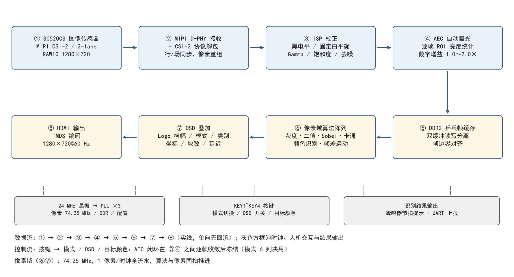
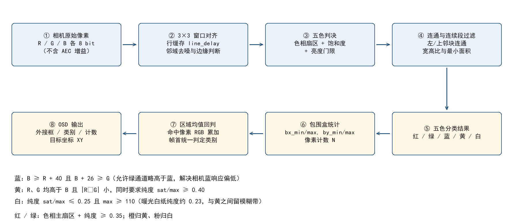
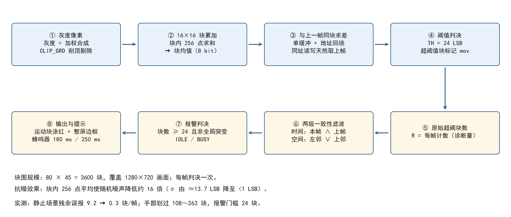

# 实时图像处理与颜色分拣识别平台

安路 HX1P35A（PH1P35MDG324，-3）上的一条纯 Verilog 视觉流水线。MIPI CSI-2 两 lane RAW10 进，
ISP 校正、自动曝光，DDR2 乒乓缓存，七种模式实时处理，HDMI 1280×720@60 出。没有 CPU、没有软核、
没有操作系统，像素域 74.25 MHz，一拍一个像素。

工具链：Tang Dynasty 6.2.168116



## 编译与下载

```bash
git clone <this repo>
```

1. 用 TD 6.2 打开 `project_src/td_project/camera_to_dsi_display.al`。
   工程里源码用相对路径 `../user_source/...` 引用，若提示路径变更，把工程根目录指到本仓库即可。
2. 器件与速度等级（PH1P35MDG324 / -3）已写在 .al 里，不用改。
3. 综合 → 布局布线 → 生成比特流 → 板载 AL-LINK 下载，或固化到 QSPI Flash。

不想编译的话，[Releases](https://github.com/xys663/fpga-color-sorting-vision/releases/tag/v1.0)
里有上板验证过的 `camera_to_dsi_display_v12.bit`，用 TD Programmer 直接下载即可。

## 七种模式

KEY1、KEY2 循环切模式，KEY3 开关 OSD，KEY4 切换目标颜色（AUTO / RED / GRN / BLU / YEL / WHT）。

| 模式 | 名称 | 内容 |
|---|---|---|
| 0 | RAW | 原图直通，用来验证 MIPI → DDR2 → HDMI 这一段 |
| 1 | GRAY | 加权灰度 |
| 2 | BIN | 固定阈值二值化 |
| 3 | EDGE | Sobel 边缘 |
| 4 | TOON | 边缘置黑加颜色量化 |
| 5 | FIND | 五色目标检测：外接框、类别、个数、左上角坐标 |
| 6 | MOTN | 16×16 块帧差运动检测：运动块涂红、块数上屏、蜂鸣器提示 |

## 模块

自研 RTL 都在 `project_src/user_source/hdl_source/img_proc/` 下。

| 文件 | 做什么 |
|---|---|
| `design_top_wrapper.v` | 时钟复位、外设例化、顶层连线、蜂鸣器节拍 |
| `hdmi_mixer.v` | ISP 校正、自动曝光、算法调度、OSD 合成、像素选择 |
| `key_ctrl.v` | 20 ms 消抖，模式 / OSD / 目标颜色三组状态 |
| `img_algo.v` | 灰度、二值化、Sobel、卡通化 |
| `line_delay.v` `window3x3_gray.v` | 整行延迟与 3×3 邻域对齐 |
| `color_obj_detect.v` | 五色判决、包围盒统计、区域均值回判 |
| `motion_detect.v` | 块图帧差、两级滤波、块计数与诊断量 |
| `osd_text_rt.v` `bin2bcd.v` `osd_overlay.v` | 8×8 点阵字库、进制转换、叠加合成 |

采集、ISP、DDR2、HDMI 这几段沿用官方例程（`isp/`、`ph1p35_ddr/`、`mipi_dphy_rx/`、`uics520_cfg/`），
改的是预处理参数和上面这些模块。

## 颜色检测

先按色相扇区粗分，再用饱和度和亮度做纯度门槛，最后用区域均值回判一次类别，避免单像素噪声让标签乱跳。



几个判据是照着相机实际输出改的，不是照教科书色值：

- 蓝：`B ≥ R + 40` 且 `B + 26 ≥ G`。传感器绿通道量子效率最高、蓝最低，日光灯下白纸的 B 只比 G 低，
  原始像素里靠"B 比 G 高"根本框不出蓝图。
- 黄：`R、G 各 ≥ B + 26`，且 `dRG ≤ 26`，且 `sat/max ≥ 0.40`。只比差值的话，暖光下的白纸天然 R>G>B，
  会被当成黄；白与黄的色相只差几度，只能靠纯度分开（白纸 0.20～0.30，真黄 0.52～0.74）。
- 白：`sat/max < 1/4` 且最亮通道 ≥ 110。门槛从 1/6 放宽到 1/4，因为暖光白纸的纯度是 0.23。
- 所有类别都要求饱和度 ≥ 20、亮度 ≥ 46，把灰面和暗角挡在外面。

## 运动检测

画面切成 80×45 个 16×16 块，共 3600 块。块内累加灰度求均值，与上一帧同块相减，超阈值置标，
然后过两级滤波：两帧都超才算数（时间一致性），再要求左邻或上邻也超（空间连通）。超过 24 块驱动
蜂鸣器，响 180 ms、周期 250 ms。



阈值 24 是量出来的：现场 98 帧录像逐帧数屏上红块，静止时平均 9.2 块、尖峰 50，按两级滤波的留存率
反推块差标准差约 13.7 LSB，阈值 18 只有 1.3σ。抬到 24（1.75σ）后残余 0.3 块/帧，而手划过时块差在
40～150 LSB，还留 1.6 倍余量。

模式 6 下先把自动曝光锁住：等增益收敛 16 帧、再等 2 帧让帧差历史干净，然后才允许判决。测光环路一直在
改亮度的话，帧差算出来的是增益变化而不是运动，这一条不锁就会出现满屏红块。

## 资源占用

| 项目 | 综合 | 布局布线 |
|---|---|---|
| LUT | 11660（slice 8922，42.1%） | LUT6 8904（41.97%） |
| 寄存器 | 9493 | 9229 |
| ERAM | 47 / 108 | 47 / 108 |
| DSP | 21 / 40 | 21 / 40 |
| ERROR | 0 | 0 |

## 已知问题

- 运动块比手晚一帧出现（约 17 ms），判决要用上一帧。
- 手停在画面里不动不报警，帧差法本身检不出静止目标。
- 画面最左一列与最上一行没有左邻、上邻，连通判据会把这两条边上的块削掉。
- clk1 上有一条准静态通路（复位与配置类信号）存在建立时间违例，最差裕量 −23.4 ns，不影响出图与识别，
  下一版用多周期约束和流水拆分收敛。

比特流不进仓库（1.8 MB 二进制），放在 [v1.0 Release](https://github.com/xys663/fpga-color-sorting-vision/releases/tag/v1.0) 里，
需要直接跑板子的人下那一个文件就够了。
